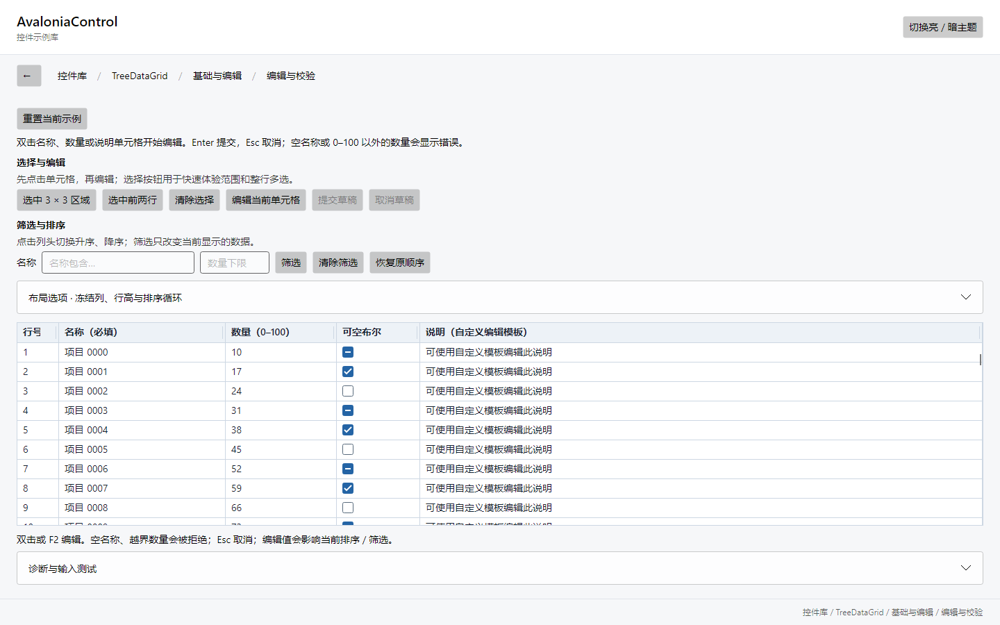
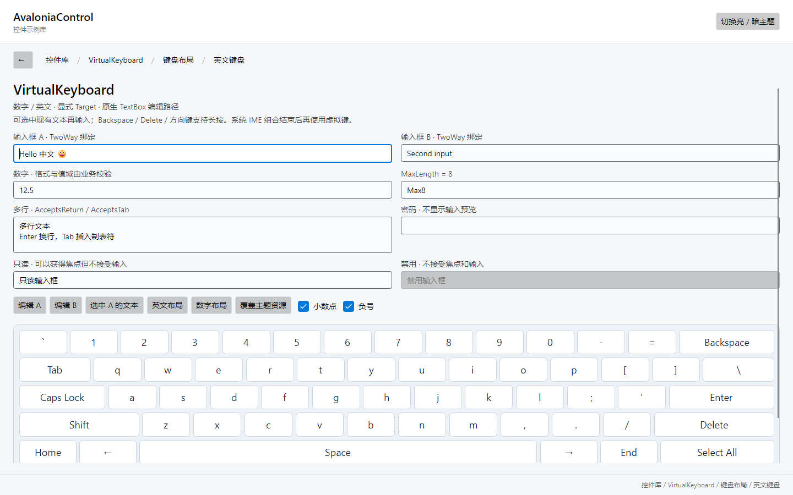
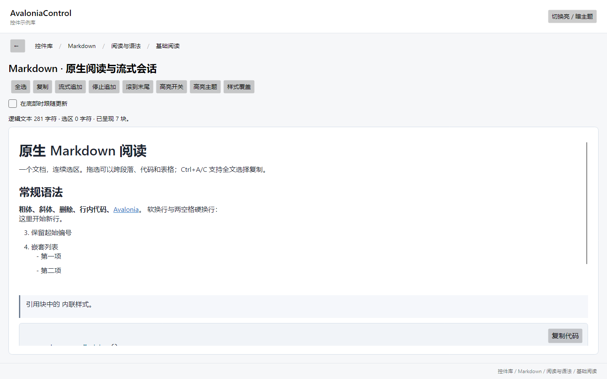
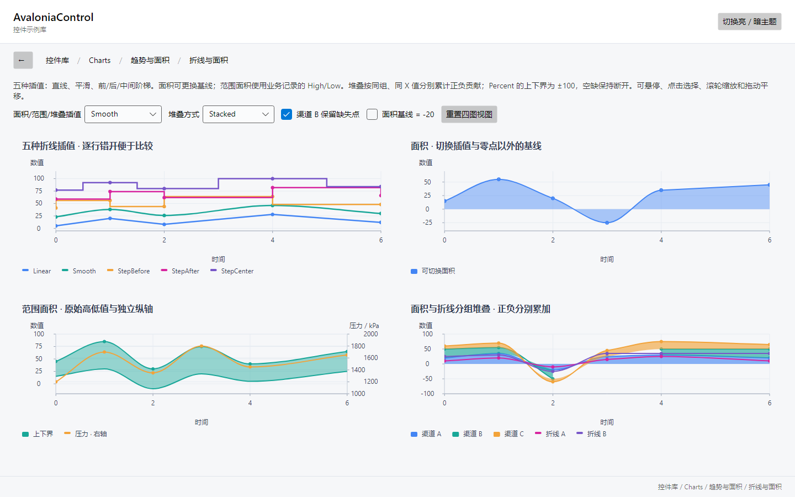
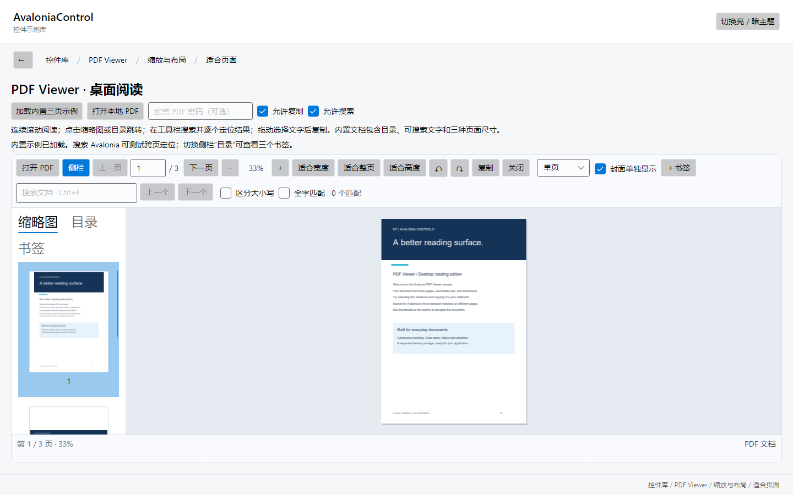

# NT.AvaloniaControl

项目标识已于 2026-10-23 统一为 `NT`。解决方案为 `NT.AvaloniaControl.slnx`，控件库、NuGet 包、程序集、C# 命名空间、XAML `clr-namespace` / `avares` 地址和 Demo 均使用 `NT.AvaloniaControl` 前缀。消费项目需要同步更新引用并重新编译。迁移范围与验证说明见[项目命名说明](docs/project-naming.md)。

Charts C6-04～C6-06 本轮补充：排程四模式、运营分析十一模式、五类剩余层级图，以及 Marker/Line/Vector/Pie、分类着色和座位多选。Demo 与 `samples/Charts.Usage` 提供 26 个实际示例，包含业务路径、标量 Bullet/KPI/Waffle、可绑定条件表列、原始来源选择及通知/卸载处理。数值入口为 `ChartSchedule`、`ChartOperational`、`ChartHierarchy` 和 `ChartMaps`；接入方式见[Charts README](src/NT.AvaloniaControl.Charts/README.md)及[Usage README](samples/Charts.Usage/README.md)。本段只描述已落地的接入范围，本轮正式 Windows/Linux 结果由阶段报告封存后发布，下方已有数字继续保留各自历史批次身份。

C6 主项的软件接入与完整官方 API/性能等价分别追踪：词云旋转/更紧密排布、专业标签和模板、所有图族的完整 C2 集成、交易/业务领域扩展及 C7 物理平台/长期稳定性仍有剩余。按用户决定，先推进 C6，再回补 C5；C5 七类缺失统计图及高级统计/金融能力仍未收口。百万点命中尾延迟和 A11Y-NATIVE-01 继续后置，既有 `C7-NATIVE-LOD-AV-01` 原生崩溃没有因新图族通过而关闭。逐项目录和边界见[开发计划](docs/charts-development-plan.md)与[官方对照清单](docs/charts-official-alignment.md)。

Charts C6-03 已完成离线分层地图五种模式，Windows与WSL2/WSLg各通过2617项Charts测试、3286项Demo检查；详见[开发报告](docs/charts-c6-geographic-maps.md)。极小单点fit、换源订阅释放及既有LOD原生AV仍列为开放问题，正式性能和物理平台验收待专项。

Charts C6-02 已完成流向和关系九种模式，Windows与WSL2/WSLg各通过2515项Charts测试、3044项Demo检查；详见[开发报告](docs/charts-c6-flow-relations.md)。C7-NATIVE-LOD-AV-01（既有LOD原生AV）未解决；正式性能和物理平台验收继续开放。

Charts C6-01 已完成六类层级和打包图、展开/钻取和变更动画，Windows与WSL2/WSLg各通过2393项Charts测试、2644项Demo检查；详见[开发报告](docs/charts-c6-hierarchy-packing.md)。正式性能和物理平台验收继续开放。

C5-05 当前执行（2026-10-21）：已完成发散条、哑铃、Mekko、镜像条、人口金字塔、龙卷风和 Venn 七类进阶比较图。支持中心/镜像共尺度、稳定排序、父列与子段身份、独立端点/侧别/交集选择、嵌套通知与错误恢复、缩放平移和导出；Demo提供八面板及参数操作，三集合Venn使用七色与外置读数表，分别显示精确独占值和圆形表示值。两集合交集解析反解，三集合为公开误差的圆形近似。

C5-05 双平台验证：同一 source-v1 在 Windows 与 Ubuntu26.04 WSL2/WSLg 的 run-v1 各通过2288项测试、2300项完整原生Demo（440项本轮）、491项Usage，两类新缓存包消费者各676项；45个固定数值及两个10万条全量布局、38张专图/18对96DPI原生导出逐RGBA零差、原始来源和每个交集区域命中/选择通过，另测144/192DPI。每平台保留40张新增比较图截图，Release零警告/错误，API243→268且既有类型/成员声明保留。见[C5-05报告](docs/charts-c5-advanced-comparison.md)、[验证清单](docs/charts-c5-advanced-comparison-validation.json)和[API](docs/charts-c5-advanced-comparison-api.txt)。

C5-05 验证记录：修复Venn组合几何在Headless后端仅按包围框命中的问题、超大基线下原始值重建丢失、无效子数据后的嵌套集合观察恢复，并避免稳定交互扫描全部图元。保留首轮失败和回归测试；绑定夹具增加排序前身份前置检查，原连续无getter选择测试不变。独立数值工具原将整数形式的面积预期误作离散计数严格比较，修正为沿用原浮点门槛，原失败证据保留，整数计数/索引规则和原输入、ROI、容差未放宽。

C5-05 后续：下一主项C6-01层级和打包。C5计划五个主项的软件范围已推进，ST01/03/06–10等统计缺项及完整官方目录仍开放；高级标签/C2集成、四集合以上Venn与更强面积拟合、自定义事件访问器主动重入的订阅硬化、增量/后台计算、正式性能和物理设备验收仍在后续。单次10万条诊断不代表p95/FPS/进程内存/长稳SLA，百万点hit尾延迟及A11Y-NATIVE-01继续后置。下方历史阶段“下一项”以本段为准。

C5-04 当前执行（2026-10-21）：已完成 Carpet 参数网格、Hexbin、Smith 阻抗/导纳、Ternary 三元图和 Wind Rose 五类工程图与专业坐标。支持物理单位、投影/逆变换、双线性插值、频数/密度聚合、原始成员身份、选择、键盘、缩放平移和导出；Demo 提供六个面板及参数操作，Usage 和独立包消费者接入编译绑定。重分箱按原始成员身份追踪选择；数值或预算错误通过 DataError 显示并可随有效数据恢复。

C5-04 双平台验证：同一 source-v1 在 Windows run-v1 与 Ubuntu26.04 WSL2/WSLg run-v2 每平台通过2236项测试、1860项完整原生 Demo（其中146项工程图）、462项 Usage，两类新缓存包消费者各639项。独立63个固定数值场景及2个10万条聚合场景、22张专图和全部原始成员检查通过，10对96 DPI原生/导出图像逐RGBA零差异，另测144/192 DPI；每平台保留24张新增工程图截图。Release零警告/错误，API219→243，既有类型和成员声明保留。见[C5-04报告](docs/charts-c5-engineering-projections.md)、[验证清单](docs/charts-c5-engineering-projections-validation.json)和[API](docs/charts-c5-engineering-projections-api.txt)。

C5-04 验证记录：修复Hexbin浮点边界归属、可表示Mean被中间求和溢出拒绝、resize/rebin选择错位，以及超大聚合值从绘制泄漏异常；保留相应失败证据和回归测试。Linux首次正式run的末项元数据工具误把本机路径转换为Windows路径，原失败保留；仅修复工具平台路径判断，Windows补核结果完全一致，Linux用全新缓存完整重跑通过，原数值、像素和身份门槛不变。

C5-04 后续：下一主项C5-05进阶比较。专业标签/轴格式、完整C2多轴/联动/模板/动画、非矩形Carpet与更广工程模型、增量/后台聚合、正式性能和物理设备验收仍开放；单次10万条诊断不代表p95/FPS/进程内存/长稳SLA。ST03及其他统计缺项不计入本轮完成范围，百万点hit尾延迟和A11Y-NATIVE-01继续按用户决定后置；下方历史阶段“下一项”以本段为准。

C5-03 当前执行（2026-10-21）：已完成 SMA/EMA/WMA/TMA 四类均线，Linear/Polynomial/Exponential/Logarithmic/Power/MovingAverage 六类趋势，以及 SMA/EMA/WMA/Bollinger 指标对象。支持源系列关联或独立输入、附加趋势、预测范围、完整历史与缺口预热、数据通知更新及依赖生命周期；Tooltip/Trackball 区分计算值、原始端点和合成拟合采样。Demo 的 Charts“技术指标与趋势”提供六图、周期/模型切换、追加/替换数据、金融叠加和局部历史视图，Usage 与独立包消费者接入编译绑定。

C5-03 双平台验证：冻结 source-v2 在 Windows run-v3 与 Ubuntu26.04 WSL2/WSLg run-v2 每平台通过2173项测试、1714项原生 Demo、446项 Usage，两类新缓存包消费者各617项；60个固定数值场景和4个规模场景、26张专用图像及原始来源检查通过，2对基础布林带96 DPI原生/导出图像零差异，SMA另测144/192 DPI，每平台保留28张新增技术图截图。Release零警告/错误，API203→219，既有类型和成员声明保留。见[C5-03报告](docs/charts-c5-technical-trends.md)、[验证清单](docs/charts-c5-technical-trends-validation.json)和[API](docs/charts-c5-technical-trends-api.txt)。

C5-03 验证记录：此前Windows还原因沙箱权限/审计网络失败，以及包消费者预热NaN诊断JSON序列化失败，均保留原始证据；最终按正常审计和原门槛重新验证通过。开发阶段另修复被引用来源移除后绑定上下文丢失、隐藏中间分析依赖更新、读数与旧API声明兼容等问题，没有以删除断言或放宽数值门槛替代修复。

C5-03 后续：下一主项C5-04工程图与专业坐标。当前追加更新仍重新计算完整历史，数学/映射可同步执行；10万点计时是单次诊断，增量计算、异步调度、金融正式性能SLA、物理设备/present和长期稳定性仍开放。RSI/MACD等AN16未核验算法不计入本轮官方范围，百万点hit尾延迟和A11Y-NATIVE-01继续按用户决定后置；下方历史阶段“下一项”以本段为准。

C5-02 当前执行（2026-10-21）：已完成蜡烛、OHLC、Hilo、Heikin-Ashi、Renko、Kagi、Point & Figure，以及共享交易槽和价格/成交量双轴的 FinancialChart 组合宿主。Demo 的 Charts“金融价格”节提供七图、数据替换与追加、箱宽/反转参数、日期对齐叠加和视图恢复；Usage 与两类隔离包消费者接入编译绑定、数据通知、选择和原始来源追溯。

C5-02 双平台验证：同一 source-v1 冻结候选在 Windows 与 Ubuntu26.04 WSL2/WSLg 每平台通过2109项测试、1584项原生 Demo、426项 Usage，两类新缓存包消费者各593项；独立数值490103项谓词和像素537项谓词通过，16对基础96 DPI导出与原生图像零差异，缩放、多轴和144/192 DPI另测。每平台保留46张金融截图，Release零警告/错误。见[C5-02报告](docs/charts-c5-financial-prices.md)、[验证清单](docs/charts-c5-financial-prices-validation.json)和[API](docs/charts-c5-financial-prices-api.txt)。

C5-02 数据约定：原始OHLC时间按UTC瞬间严格递增，预计算图元可共享时间；MapTime仅映射最终Samples保留的时间，同时间多图元取最后槽，其余日期形成缺口。宿主自动配置价格/成交量双轴，单独使用FinancialVolumeSeries需自行配置轴。输出预算同时检查生成与预计算样本准入，P&F按X/O字母计数；该预算不是输入物化或进程/原生/GPU实际内存硬限。

C5-02 后续：下一主项C5-03技术指标与趋势。当前采用close-only固定阈值变换，交易所日历/盘中会话、ATR/百分比/逐笔变体及官方运行时/API等价仍开放；10万/2048样本计时为单次诊断，金融性能SLA、物理平台/present与长期稳定性尚待专项验证。百万点hit尾延迟和A11Y-NATIVE-01继续按用户决定后置，下方历史阶段“下一项”以本段为准。

C5-01 当前执行（2026-10-21）：已完成箱线、对称/非对称误差、直方图与核密度系列，以及 Type 7 分位数、Tukey 须线/离群值、描述统计、正态近似均值区间、ECDF 和 Pearson 相关。Demo 的 Charts“统计与分布”节支持原始/预聚合箱线、均值/离群点、误差方向、分箱数与带宽；Usage 和两类包消费者接入编译绑定、选择和数据更新。

C5-01 双平台验证：冻结 source-v1 在 Windows 与 Ubuntu26.04 WSL2/WSLg 每平台通过2027项测试、1470项原生 Demo、410项 Usage，两类新缓存包消费者各574项；独立数值1660/1660、原生像素247/247，8对基础96 DPI导出与原生图像零差异，多轴与缩放另测，密度曲线追加144/192 DPI验证。Release零警告/错误，公开API类型173→188，既有声明保留。见[C5-01报告](docs/charts-c5-statistics-distributions.md)、[验证清单](docs/charts-c5-statistics-distributions-validation.json)和[API](docs/charts-c5-statistics-distributions-api.txt)。

C5-01 后续：下一主项 C5-02 金融价格图。本轮完成指定统计核心范围，其余统计目录、加权统计、小样本 Student-t 区间及密度边界修正等仍开放；KDE为样本数乘采样点数的同步数值计算，10万/2048样本诊断不认证统计图性能SLA。完整C5、官方运行时/API等价、物理设备/GPU/present与长稳资格仍开放；百万点hit p95、A11Y-NATIVE-01和历史问题继续保留。下方历史阶段“下一项”以本段为准。

C4-08 当前执行（2026-10-20）：已将 benchmark、真实原生窗口驱动、原始数据/trace 和独立差异守卫接入 CI，顺序执行九个性能任务；检查计时、分配、失败率、原始数据身份和像素差异，保留基线、失败样本、日志、截图及策略/源码/载荷哈希。性能矩阵覆盖 Windows2025、Ubuntu22.04/24.04，PR 使用独立 base 产品与相同候选驱动。

C4-08 双平台验证：同一冻结 source-v1 在 Windows 与 Ubuntu26.04 WSL2/WSLg 每平台通过1939项 Charts 测试、1414项原生 Demo、393项 Usage，两类新缓存包消费者各553项；39项 Python 契约、30项 PowerShell 监督检查和15项重叠的主守卫入口检查通过。每平台九个性能任务零失败，严格守卫4204/4204，同候选独立基线与当前窗口各56个样本通过，Release零警告/错误。见[C4-08报告](docs/charts-c4-ci-performance-gates.md)、[验证清单](docs/charts-c4-ci-performance-gates-validation.json)和[API](docs/charts-c4-ci-performance-gates-api.txt)。

C4-08 后续：下一主项 C5-01 统计与分布。GitHub远端工作流尚未执行；本地同版本对照不能证明历史版本提速，原生驱动显式关闭 tiered compilation 的结果不认证应用默认JIT性能。保留先前实际p50门禁失败及诊断，完整C4固定硬件SLA、物理平台、present/GPU、实际内存和长稳资格仍开放；百万点hit p95、A11Y-NATIVE-01与历史问题继续保留。下方历史阶段“下一项”以本段为准。

C4-07 当前执行（2026-10-20）：完成多图 FIFO 合并刷新、隐藏/卸载生命周期、可取消且隔离旧版本的后台数字路径准备、进程五层缓存/在途任务估算预算及公开统计；Demo新增六图面板，Usage与包消费者完成编译绑定接入。后台默认关闭，数据映射/投影/轴/原生绘图仍在UI线程；公平的是失效请求轮次，不承诺整图CPU均分。

C4-07 双平台验证：同一 source-v2 冻结候选在 Windows 与 Ubuntu26.04 WSL2/WSLg 每平台通过 1939项Charts测试、1414项完整原生Demo、393项Usage，两类全新缓存包消费者各553项，Release零警告/错误；十阶段通过。固定四图机制17项门槛及新增两主题12张PNG的同步/后台、原始数据与业务ROI独立审查通过，不认证物理桌面、GPU/present、完整UI帧公平、长期内存或正式SLA。见[C4-07报告](docs/charts-c4-multichart-background-layout.md)、[验证清单](docs/charts-c4-multichart-background-layout-validation.json)和[API](docs/charts-c4-multichart-background-layout-api.txt)。

C4-07 后续：下一项 C4-08 自动化性能门禁。共享索引/CWT/已发布预备路径、旧快照/调用方对象、原生/GPU和实际进程内存预算、未覆盖图族/域的同步N路径与30分钟/8小时长稳仍开放；降低预算时运行任务继续计费直到合作取消完成。百万点hit p95按用户决定后置，A11Y-NATIVE-01、AX06、四份PixelProbe DLL及旧动画/长路径问题保留。完整C2/C3/C4/C7及官方对照仍开放，下方历史阶段“下一项”以本段为准。

C4-06 当前执行（2026-10-20）：完成系列绘图、轴/交互文字、轴画笔与线段几何的本地共享预算，公开 ResourceCacheBudgetBytes/GetResourceCacheInfo/TrimResourceCaches，支持清理、禁用和可变画刷；ChartDataBuffer 提供 StoragePageCount 与显式 Compact 压实，保留原始记录、选择与旧快照。预算是Model1逻辑估算，不是进程/原生/GPU实际字节硬上限；共享数据/命中/LOD与source/series/context缓存、调用者对象和临时工作仍在五层账本之外。

C4-06 双平台验证：同一冻结候选的两物理副本在 Windows 与 Ubuntu26.04 WSL2/WSLg 每平台通过 1893/1893 项 Charts 测试、1384/1384 项原生 Demo、380/380 项 Usage，两类全新缓存包消费者各 538/538，Release 零警告/错误。九阶段完成，C4-01～C4-05继承原门槛重跑；新增20k点分配诊断、3000原始线段对、五层预算及2048→8页压实 oracle通过。每平台资源14图中12图独立解码并核对业务ROI/整图一致性。短时进程快照和线程分配不认证长期内存、原生/GPU、FPS或present。见[C4-06报告](docs/charts-c4-render-resource-budgets.md)、[验证清单](docs/charts-c4-render-resource-budgets-validation.json)和[API](docs/charts-c4-render-resource-budgets-api.txt)。

C4-06 后续：下一项 C4-07 多图与后台布局。进程/共享索引/旧快照和任意业务对象预算、自动压实、复杂图族N路径、公平调度、30分钟/8小时长稳及真实backend/GPU/present继续开放。百万点hit p95历史0.7649→1.1235ms仍按用户决定后置；A11Y-NATIVE-01、AX06、四份PixelProbe DLL缺口与C4-03旧导出动画时序失败未关闭。完整C2/C3/C4/C7及官方对照仍开放，下方历史阶段“下一项”以本段为准。

C4-05 当前执行（2026-10-20）：完成 `ChartDataBuffer<T>` 分页有限窗口和追加/插入/删除/替换、`ChartStreamingSession<T>` 后台到 UI 的两批有界队列、背压、合并、暂停恢复、取消与统计；`DeferDataUpdates` 合并多源提交，`FollowLatestData/FollowLatestWindow` 支持暂停跟随历史窗口与恢复追到最新。Demo 新增四路实时画板，Usage 和两类仅包消费者使用编译绑定公开 API，原始 StableId/Item 保持，SourceIndex 随当前窗口重定位。

C4-05 双平台验证：相同冻结候选的两个物理副本在 Windows 与 Ubuntu26.04 WSL2/WSLg 每平台通过 1868/1868 项 Charts 测试、1320/1320 项原生 Demo、361/361 项 Usage，两类全新缓存包消费者各 517/517，Release 零警告/错误。四路共百万行的120轮源更新及12轮真实 Headless 附图、原始身份/快照/队列/跟随 oracle 与两主题原生像素检查通过；C4-01～C4-04机制保持原门槛重跑。源更新每轮复制/映射500行的结论仅适用已测路径；目录仍有 O(P)、多种派生索引仍有 N 级工作。虚拟节奏、线程分配和 DrawingGroup 不认证持续吞吐、总内存、首次可用、尾延迟、FPS 或 present。见[C4-05报告](docs/charts-c4-incremental-streaming.md)、[验证清单](docs/charts-c4-incremental-streaming-validation.json)和[API](docs/charts-c4-incremental-streaming-api.txt)。

C4-05 后续：下一项 C4-06 绘图与资源预算。页碎片/压实、旧快照和任意业务对象的字节预算、日期/对数/断轴/自定义域与未覆盖图族的全量路径、多图公平调度、30分钟/8小时长稳和物理平台/backend/present继续开放。百万点 hit p95 历史回退0.7649→1.1235ms仍按用户决定后置；A11Y-NATIVE-01、AX06、四份PixelProbe DLL缺口与C4-03旧导出动画时序失败未关闭。完整C2/C3/C4/C7及官方对照仍开放，下方历史阶段“下一项”以本段为准。

C4-04 当前执行（2026-10-20）：完成原始点二维索引、原始相邻线段索引、密集共享 X/Y 读数与共享柱布局命中。稳定内置笛卡尔投影保留短 X 候选窗口，密集/非有序候选使用层级查询并执行原有精确几何规则；标记、重叠点及并列按实际绘制/物理顺序确定。各系列使用各自坐标轴，MinMax 显示与交互索引分离，Tooltip、选择和线段端点继续返回原始源索引、StableId、Item 与既有 RawPoint。Demo 展示重叠、同 X、独立右轴、抽样遗漏原始点、相邻线段、换源和两组柱体；无新增公开 API。

C4-04 双平台验证：候选 `c4-efficient-hit-source-v1` 在 Windows 与 Ubuntu26.04 WSL2/WSLg 每平台通过 1817/1817 项 Charts 测试、1266/1266 项原生 Demo、344/344 项编译绑定 Usage；两类全新缓存隔离包消费者各 498/498 项，Release 零警告/错误。12个固定命中诊断场景各10次预热查询，独立完整原始数据 oracle 核对点、Tooltip、选择和线段；C4-01～C4-03机制与既有业务像素门槛重跑通过。计时/分配仅作诊断，工作量门禁不代表全部输入的复杂度或正式尾延迟/FPS SLA。见[C4-04 报告](docs/charts-c4-efficient-hit.md)、[验证清单](docs/charts-c4-efficient-hit-validation.json)和[API](docs/charts-c4-efficient-hit-api.txt)。

C4-04 后续：下一项为 C4-05 增量与实时调度。首次构建、极端重叠/跨视口长段、未知变换和复杂形状仍可能访问大量数据；平滑/阶梯、面积/范围段沿用正确保守路径。百万点 hit p95 历史回退0.7649→1.1235 ms按用户决定留后续专项，资源预算、长期内存、物理平台/backend/present和官方运行时对照继续开放。Windows UIA/Linux AT-SPI选中枚举保留延期 A11Y-NATIVE-01，C4-03旧导出动画夹具的暂停前置状态时序问题、AX06和四份PixelProbe DLL缺口未关闭。下方历史阶段文字保留原记录，其中“下一项”以本段为准。


C4-03 历史执行（2026-10-19）：完成显式线性折线 MinMax 保真抽样和层级细节。按不可变坐标版本复用分块极值层级，按 TopLevel.RenderScaling 或显式导出比例的像素桶保留首末点和峰谷，映射/补值后仍非有限的断点独立，保留边界邻点；已有 EmptyPointMode 补值连续语义不变。LineSeries.SamplingMode 默认 None，沿用 C4-02 原始细节/可见裁剪路径；显式 MinMax 适用于单调 X、线性且未堆叠、无标记/标签及稳定有效内置投影的实色折线，不适用场景保守回退并给出原因。Tooltip、点/矩形选择仍查询原始数据。Demo 提供10万/100万点、模式/物理桶宽及峰谷/断点缩放；导出默认原始细节，可显式按输出像素抽样。

C4-03 双平台验证：候选 `c4-level-of-detail-source-v1` 在 Windows 与 Ubuntu26.04 WSL2/WSLg 每平台通过 1730/1730 项 Charts 测试、1232/1232 项原生 Demo、332/332 项编译绑定 Usage；两类全新缓存隔离包消费者各 486/486 项，Release 零警告/错误。10个抽样诊断场景各10次视口变化，7个适用稠密夹具精确通过独立原始桶峰谷/断点/身份 oracle，预热源访问和层级重建为0；3个保守场景明确回退。C4-01 缓存、C4-02 裁剪及既有业务像素门槛重跑通过。计时/分配只作诊断，不代表正式 SLA。见[C4-03 报告](docs/charts-c4-level-of-detail.md)、[验证清单](docs/charts-c4-level-of-detail-validation.json)和[API](docs/charts-c4-level-of-detail-api.txt)。

C4-03 后续：下一项为 C4-04 高效命中。非有序/平滑/阶梯/堆叠/面积/范围等仍使用原路径；柱状/散点密度聚合尚未定义语义，极多断点的保真输出仍可接近 N。任意祖先 RenderTransform/Viewbox 组合变换的密度资格、百万点 hit p95 历史回退 0.7649→1.1235 ms、增量/实时调度、缓存字节预算、长期内存和物理平台/backend/present 资格继续开放。Windows UIA/Linux AT-SPI 原生选中枚举保留用户延期的 A11Y-NATIVE-01；完整 C2/C3/C4–C7、官方等价和历史 AX06/四份 PixelProbe DLL 缺口未关闭。下方此前阶段文字保留历史状态，其中“下一项”以本段当前进度为准。


C4-02 历史执行（2026-10-19）：完成 CartesianChart 内置系列的可见数据裁剪，覆盖几何、保留绘图和矩形选择；小型线性折线、空间画刷和未知投影采用保守路径。在稳定的内置 Cartesian 投影下，有序 X 使用范围查询，非有序与二维数据使用按不可变坐标版本复用的空间索引；在既有渲染器最终可见性规则内保留穿越视口的线段端点、曲线所需邻点、带状区域和标记覆盖边缘。裁剪只筛选原始序号，不复制成新的数据源，Tooltip 与点/矩形选择继续返回原始 Item、SourceIndex、StableId 和 RawPoint。未知自定义投影保持保守路径。

C4-02 双平台验证：候选 `c4-visible-clipping-source-v1` 在 Windows 与 Ubuntu 26.04/WSL2/WSLg 每平台通过 1694/1694 项 Charts 测试、1188/1188 项原生 Demo、318/318 项编译绑定 Usage；两类全新缓存隔离包消费者各 470/470 项，Release 零警告/错误。9 个裁剪诊断场景各10次窄视口变化，源访问和索引所有者重建为0；这些稀疏夹具的实际投影/遍历量均低于源规模1/4，包含百万点有序折线、非有序及二维散点。C4-01 的9个 Tooltip 缓存场景也重新验证。计时/分配只作诊断，不代表正式 SLA。见[C4-02 报告](docs/charts-c4-visible-clipping.md)、[验证清单](docs/charts-c4-visible-clipping-validation.json)和[API](docs/charts-c4-visible-clipping-api.txt)。

C4-02 后续：下一项为 C4-03 保真抽样和层级细节；大量线段同时跨越视口时，真实候选仍可能达到 O(N)，裁剪不能替代 LOD。增量/实时调度、缓存字节预算、百万点 hit p95 历史回退 0.7649→1.1235 ms、长稳内存和物理平台/backend/present 资格继续开放。Windows UIA/Linux AT-SPI 原生选中项枚举仍留 A11Y-NATIVE-01；完整 C2/C3/C4–C7、官方等价和历史 AX06/四份 PixelProbe DLL 缺口未关闭。下方此前阶段文字保留历史状态，其中“下一项”以本段当前进度为准。


C4-01 历史执行（2026-10-18）：完成 CartesianChart 主数据管线与内置系列；独立图族保留各自现有缓存 的数据/视图分层失效；数据快照与类别/堆叠/范围准备、极值/基础尺度、视图投影、轴文字、系列保留绘图与交互叠加工作分开复用。移动 Tooltip 的已预热场景不重新枚举或访问整个源，不重建数据、极值、视图、轴文字、排序/命中索引或系列几何；视口只重建相关视图，源变更按版本重新准备。自定义 renderer/投影保留保守实时路径，独立非 Cartesian 图族仍沿用各自缓存。

C4-01 双平台验证：最终候选 `c4-layered-invalidation-source-v1` 在 Windows 与 Ubuntu 26.04/WSL2/WSLg 每平台通过 1622/1622 项 Charts 测试、1188/1188 项原生 Demo、318/318 项编译绑定 Usage；两类全新缓存隔离包消费者各 470/470 项，Release 零警告/错误。9 个缓存机制场景各 30 次预热、100 次记录，源访问与各层重建增量均为 0，并验证视口/源版本改变的失效。计时与线程分配只作诊断，未评估正式 SLA、实际 present 或长稳内存。见[C4-01 报告](docs/charts-c4-layered-invalidation.md)、[验证清单](docs/charts-c4-layered-invalidation-validation.json)和[API](docs/charts-c4-layered-invalidation-api.txt)。

C4-01 后续：下一项为 C4-02 可见数据裁剪；保留命中语义的范围索引、LOD、增量调度、缓存字节预算、百万点 hit p95 历史回退 0.7649→1.1235 ms 及物理设备/后端资格仍开放。保留绘图 replay 仍随绘图操作数变化，不是 O(1) present。Windows UIA/Linux AT-SPI 原生选中项枚举继续留 A11Y-NATIVE-01；完整 C2/C3/C4–C7、官方等价与历史 AX06/四份 PixelProbe DLL 缺口未自动关闭。下方 C3-07 及更早段落保留对应历史批次状态，其中“下一项”以本段当前进度为准。


## 当前进度与下一步（2026-10-18）

当前统一版本为 **0.2.0-preview.2**。五个控件均已有实现、独立默认主题和统一 Demo；功能完成、自动化通过、真实平台验收和正式发布分别记录。

| 控件 | 当前已完成的主要功能 | 待完善重点 |
| --- | --- | --- |
| TreeDataGrid | 平面/树数据、MVVM、五种列、选择编辑校验、排序过滤、冻结与虚拟化、列显隐/重排、路径定位、受控行移动 | 异步加载产品化、复制与布局持久化等增强；真实 IME、DPI、读屏、性能及麒麟验收 |
| VirtualKeyboard | 数字/英文、Shift/Caps、显式 TextBox 输入、原生编辑与撤销、长按重复、生命周期保护 | 中文输入可选引擎、自动焦点与显隐 Scope、其他编辑器适配；触屏、IME、DPI 和麒麟验收 |
| Markdown | 原生只读阅读、常用语法及表格/脚注、全文选择复制、流式更新、图片/高亮扩展、TextMate、视口回收 | HTML/数学/Mermaid 等扩展与编辑导出能力；实体 Linux、完整读屏/DPI、长期内存与目标设备验收 |
| Charts | 普通/平滑/三种阶梯折线、面积/范围面积、正负堆叠/百分比、横竖分组柱、范围柱/瀑布/Pareto/Dot/Lollipop/Variance、宽度/显示排序、散点大小/颜色编码、ScatterLine/XY Bubble、面积/直径尺度及绘制顺序、饼/环/半环/部分弧/多环、外标签连线/选择及过渡、极坐标线/散点/面积、雷达/径向线、极面积/玫瑰/径向条、角度/半径轴及圆形/多边形网格、六类仪表/四模式微图、数值域/目标/区间/液体动态选项与实时更新、漏斗/面积比例金字塔/Heatmap 及色标/Pictorial 三模式/Theme river 居中堆叠底座、对象/MVVM与完整轴底座、浮动/对齐/滚动图例、图例/数据标签/Tooltip控件模板、十种标记、SharedX/SharedY、线段插值/横竖Trackball、方向十字线/多轴读数、点与系列选择/前置取消、横竖范围条/多图主轴同步、触摸捏合/平移与连续双轴滚动/嵌套仲裁、形状标注、入场/数据/视图动画及暂停/取消/减少动态、PNG/JPEG同步/异步导出及尺寸/背景/DPI/取消、点级辅助分页/选择/命令、独立键盘浏览/数据摘要/显式高对比、Usage/包消费者 | 异构堆叠连续共边、柱体圆角/独立描边与完整逐点样式、类别图例/标签高级布局、未来图族标注/动画/辅助语义、原生选中集合/Linux已选子节点枚举与嵌套点选择写入、点焦点/真实读屏与系统偏好/图案、内嵌范围概览/跨图游标、更多图族、LOD/实时长稳、系统保存选择器与物理输入/Linux实机及官方性能对照 |
| PdfViewer | PDFium 加载与阅读、单页/连续/双页布局与封面规则、页标签、搜索/目录/缩略图、缩放旋转、链接与完整目的地（外链交宿主拦截）、会话用户书签、跨页选择复制、触摸捏合缩放与快捷键契约、缓存调度 | 渐进搜索/文本与图片导出、书签 PDF 持久化、性能画质、编辑保存/批注/表单/打印；Linux/麒麟及设备矩阵 |

下一步补真实平台验收；Charts C4-07 多图与后台数字布局已通过双平台软件验证，下一主项为 C4-08 自动化性能门禁；C2 收尾/无障碍专项、C3 图族完整适配和 C4 绘图/增量预算继续开放。其他控件继续 PdfViewer 渐进搜索等 P2 剩余项与 Linux 回归、TreeDataGrid 异步加载、VirtualKeyboard 中文输入原型，以及 Markdown 设备与长期运行证据。

完整的已完成清单、未实现与待验收边界、逐控件执行顺序及本次验证记录见 [当前功能状态与下一步计划](docs/current-status-and-next-steps.md)。各控件下方的阶段文档保留历史数据，旧测试总数和旧产物结论不代表当前整个仓库。

Charts 当前执行更新：2026-10-18。

C3-07 历史实现（2026-10-18）：新增 FunnelChart、PyramidChart、HeatmapChart，提供真实业务数据映射、源项命中、Tooltip、基础选择、键盘浏览及 PNG/JPEG 同步/异步导出。PictorialBarSeries 接入现有 Cartesian 管线，支持符号 Stretch、Clip、Repeat、方向/间隔与实际形状及孔洞命中；ThemeRiverStack.CreateBaseline 提供堆叠面积组合所需的居中透明底座。Demo「基础分析图」的七张图卡、真实编译绑定 Usage 和两类隔离包消费者均接入；此为本库自有软件契约，不代表官方完整 API 或运行时等价。

C3-07 数值契约：漏斗与金字塔仅对有限正数创建阶段，保留源顺序和原始数值；漏斗按值/最大值与 NeckWidth 计算连续边界，金字塔在无间隔时按正数面积比例分层；间隔删除实际绘制面积而不改业务值，不宣称带间隔面积仍严格等比。Heatmap 行列按类型化键首见顺序建立，重复单元最后源项胜出（包括无效末项），不存在的组合不制造业务点；颜色域、缺失填充和实际色标分别展示。Pictorial 三模式裁剪到数值柱体与 PlotArea，不用包围盒填补孔洞；零值无柱体。Theme river 输入必须槽位对齐、有限且非负，透明正向 spacer 与已有 AreaSeries 同组堆叠；该底座已实现 silhouette 式居中规则；wiggle、优化流顺序及更多基线算法尚未验收，也不虚列独立官方 Theme river 系列。

C3-07 正式验证：最终候选 `c3-analysis-source-v1` 在 Windows 与 Ubuntu 26.04/WSL2/WSLg 每平台通过 1500/1500 项 Charts 测试、1188/1188 项原生 Demo 检查、318/318 项编译绑定 Usage 检查，功能包/主题包两类全新缓存隔离消费者各 470/470 项；Release 构建零警告、零错误，基础/消费者/API 三阶段退出码均为 0。 结果见[C3-07 报告](docs/charts-c3-analysis.md)、[验证清单](docs/charts-c3-analysis-validation.json)与[API](docs/charts-c3-analysis-api.txt)。

C3-07 验证口径：冻结 1400 文件，两平台各 691 个声明运行输入逐项同 SHA；每平台运行前后声明源与程序集稳定，文档更新后不声称整个工作区与冻结副本相同。独立来源/平台审阅 4280/4280，PNG 审阅 981/981、实际解码 168 图，独立包载荷核对 14/14；47 个历史报告/API pin（含 C3-06 三文件）与 7 版历史 renderer 保持原 SHA。检查重叠，不合并为产品测试数。完整本地 API 类型 154→163，Charts 命名空间 152→161，新增 9 类型、既有类型增加 0 项声明；无旧类型、声明或成员删除，不代表官方或二进制兼容。 各图族原始业务数值和公开布局公式在对应首图前封存，独立解码真实 PNG，不读取生产几何、投影或命中输出作为像素预期。两主题原始与改变状态后的原生整板另行实际查看。Headless 包消费者区分真实 PNG 文件头与明确后端 NotSupported、零输出及一次 owner/UI 线程失败事件；后者是失败反馈契约通过，不是 PNG 成功。原生窗口图片、导出/DPI、源码/程序集及包消费检查均不代表物理输入、实际 backend/GPU/compositor present 或性能资格。

C3-07 修复记录：开发期原始失败与修复结果独立封存：首次 Core 缺少 Avalonia.Controls using 产生 2 个编译错误，其记录为工具转录而非原始日志；测试编译曾因生命周期夹具宿主类型不匹配失败。初始 Pictorial 投影元数据断言在延迟场景发布前读取，后续保留 Item/ID/RawPoint 断言并在绘制后有限排空 UI 任务。tests-v2 是编译失败后误用旧测试 DLL 的 77/79，明确排除为新候选验证；tests-v3 的 88/90、修复后 tests-v4 的 90/90 和 full-tests-v1 的 1494/1494 均保留原结果。首张对应图片前另修正 Heatmap 固定 gap/键、Pictorial 两极性输入、初始标签开关与只读 river 图例夹具，预注册 oracle 和像素阈值未改变。native-v1 的 Usage317/317 通过，但 Demo 在1052项检查后因生产控件 AnalysisChartBase.Render→GetMarks→SetSelected 对外通知 TextBlock 绑定，触发 compositor 的 Visual was invalidated during the render pass，进程失败；这不是夹具问题。该失败实际使用的8个DLL已在后续重建前保留并按原manifest核验。本轮随后修复生产控件，使几何构建与状态发布分离，由绘制后的单个UI任务按最新revision发布，并增加回归及默认TwoWay选择绑定。修复后 tests-v5 96/96 与 full-tests-v2 1500/1500、native-v2 Demo1188/1188、Usage318/318、两进程退出0及8DLL运行稳定按实际证据保留。全部开发失败及修复均不替代后续冻结正式验证。

C3-07 剩余：复杂漏斗/金字塔标签避让与全模板、Heatmap 非线性色阶/高级颜色轴与大矩阵虚拟化、Pictorial 全组合和高密度性能、完整 Theme river 控件、wiggle/优化流顺序/更多基线算法及 C6 分析图组合继续开放。新独立宿主的完整 C2 标注/联动/缩放/范围/Trackball/辅助语义、标准入场/数据/视图动画仍需逐族适配；既有 C3-01～C3-06 的异构共边、逐点样式、图例/布局/动画及完整 C2 残余不自动关闭。百万点命中 p95 历史回退 0.7649→1.1235 ms 继续留 C4，Windows UIA/Linux AT-SPI 原生选中项枚举继续留 A11Y-NATIVE-01；AX06 标题/末刻度布局与四个历史 PixelProbe DLL 证据缺口保留。本批完成 C3-07 指定软件范围，下一主项为 C4-01 数据与视图分层失效；完整 C2/C3/C4–C7、官方等价及物理平台门槛仍开放。

C3-06 历史实现（2026-10-18）：新增 CircularGaugeChart、GaugeChart、GradientRingChart、LinearGaugeChart、LiquidFillGaugeChart、ProgressDonutChart 六类仪表，以及 SparklineChart 的 Line/Area/Bar/WinLoss 四模式。共享数值域和目标，圆形/半圆/线性仪表的区间、多环独立数值和梯度画刷、线性横竖/方向、圆/矩形液体静态波形和显式动画/暂停/减少动态效果、微图极值/首尾/标记/缺口、业务身份与实时更新、PNG/JPEG 同步/异步导出接入 Demo「仪表与微图」、真实编译绑定 Usage 和两类隔离包消费者。此为本库自有软件契约，不代表官方完整 API 或运行时等价。

C3-06 数值契约：有效仪表域要求有限上下限且 Maximum>Minimum；Normalize 结果限制在 0–1，原始 Value/TargetValue 不改写，无效域或非有限值不绘数值。圆形/半圆/线性仪表的范围按业务值投影，多环共用域并分别显示进度。微图按原始源槽位排布，不按类别排序；默认 Gap 下非有限和缺失保留槽位并切断路径；可通过 Series.EmptyPointMode 显式填补并保留 WasEmpty 元数据。面积和柱形自动域包含 Baseline，WinLoss 按相对基线的正/负/零显示固定符号格并保留原始值。附着时观察集合与业务项，卸载释放；液体波动默认关闭，静态与导出共享绘制路径。

C3-06 正式验证：最终候选 `c3-gauge-sparkline-source-v2` 在 Windows 与 Ubuntu 26.04/WSL2/WSLg 每平台通过 1404/1404 项 Charts 测试、1048/1048 项原生 Demo 检查、295/295 项编译绑定 Usage 检查，功能包/主题包两类全新缓存隔离消费者各 432/432 项；Release 构建零警告、零错误，基础/消费者/API 三阶段退出码均为 0。 结果见[C3-06 报告](docs/charts-c3-gauge-sparkline.md)、[验证清单](docs/charts-c3-gauge-sparkline-validation.json)与[API](docs/charts-c3-gauge-sparkline-api.txt)。

C3-06 验证口径：冻结 1380 文件，两平台各 674 个声明运行输入逐项同 SHA；每平台运行前后声明源和程序集稳定，文档更新后不声称整个工作区与冻结副本相同。独立来源/平台审阅 4188/4188，PNG 审阅 869/869、实际解码 168 图，独立包载荷核对 14/14；44 个历史报告/API pin（含 C3-05 三文件）与 6 版历史 renderer 保持原 SHA。检查重叠，不合并为产品测试数。完整本地 API 类型 140→154，Charts 命名空间 138→152，新增 14 类型，既有类型声明和成员无新增、删除或改写；不代表官方或二进制兼容。 每平台两主题各 18 个首图前封存业务像素场景，使用固定 420×280 控件、原始业务值和公开布局公式独立复算，不使用生产几何/命中/GetLayout 输出当预期。6 DIP 方框、RGB 容差 24、alpha 至少 240、正像素至少 6、负像素 0；每场景 96 DPI 导出与原生捕获逐像素零差，仪表和微图代表图追加 144/192 DPI 密度与逐像素核对。十卡独立 Viewbox board 在程序化窗口内完整显示；Headless 包消费者只核对真实 PNG signature/IHDR，或唯一明确后端 NotSupported、零输出与 owner/UI 线程失败事件；后者是结果契约通过，不是 PNG 成功。原生像素资格使用上述独立原生窗口场景。这些检查不代表物理输入、桌面呈现或性能资格。

C3-06 修复记录：开发及正式 source-v1 失败证据原样保留。Usage 输入 Slider 曾通过 TwoWay 将请求 180 反写为输入上限 120；扩大示例固定输入域后保留原始值/归一值断言。Headless 不支持真实 PNG 的两项检查改为严格的成功文件头或明确受控后端失败契约，未改原生像素门槛。独立审查还定位并修复了生产生命周期问题：DataContext/挂载回调中卸载、重挂载或换父级时的仪表观察器泄漏、Sparkline 内部 Series 继承/逻辑父级和 Changed 订阅状态失配；按最新挂载状态协调拥有关系并补真实回调回归。超大有限 StartAngle 在加进度前归一化，避免浮点精度吞掉角度增量导致路径退化；超大液体相位先归一化再加已过时间。上述为生产修复，最终候选重新冻结并完整重跑，未用夹具调整替代。

C3-06 剩余：仪表数值过渡 timeline、完整 C2 模板/选择/标注/联动/缩放适配、复杂标签和区间布局、完整官方 API/组合、点级及原生辅助语义、正式 C4 性能与物理平台资格仍开放。保留 C3-01～C3-05 的异构共边、逐点样式、大小/颜色图例、圆形高级标签/图例/模板、极坐标轴/布局/动画及全 C2 适配残余。百万点命中 p95 历史回退 0.7649→1.1235 ms 继续留 C4；Windows UIA/Linux AT-SPI 原生选中项枚举继续留 A11Y-NATIVE-01，未因本批软件验证关闭。AX06 标题/末刻度布局与四个历史 PixelProbe DLL 证据缺口继续开放。该历史批后续主项为 C3-07 基础分析图；当前进度以本文 C3-07 段落为准，完整 C2/C3/C4–C7 仍开放。

C3-05 历史实现（2026-10-18）：新增独立 PolarChart 与默认多边形网格的 RadarChart，以及 PolarLine/PolarScatter/PolarFilled、Radar、RadialLine、PolarArea、NightingaleRose、RadialBar 八种系列。数值角度与分类角度分别支持角度/半径轴、度/弧度、起点/方向/部分周期、源序断点与闭合、圆形/多边形网格、轮廓/填充/标记；选择、Tooltip、基本标签及 PNG/JPEG 同步/异步导出接入 Demo「极坐标与雷达」、编译绑定 Usage 和两类隔离包消费者。这是本库自有软件契约，不代表官方完整 API 或运行时等价。

C3-05 数值契约：AnglePath/RadiusPath 分别是 CategoryPath/ValuePath 的别名，原始 Item/StableId/SourceIndex 和角度/数值保留。数值角度按线性轴范围归一化，再应用显示度数的 StartAngle/SweepAngle、方向及 WrapAngles；分类系列共享可见系列首见类别并集，重排系列仍沿同名射线。Radar.MaxValue 默认 100、null 使用共享半径域；负半径、非有限值和缺失形成缺口。等角 PolarArea 以环形面积编码，NightingaleRose 以线性半径编码，RadialBar 以同心轨道弧长编码；零值扇区不画，InnerRadius 和 SectorGap 不改写业务值。同构极面积/玫瑰的刻度使用同一数值映射，径向条类别沿轨道、值沿角度显示；异构编码组合明确标为 r/R 和 θ 参考。扇区数值圈、轨道及物理 r/R 参考固定使用真圆/部分弧，Polygon 仅作用于点/雷达/径向线的顶点参考。标签与图例为有限空间绘制式基础实现。

C3-05 正式验证：最终候选 `c3-polar-radar-source-v2` 在 Windows 与 Ubuntu 26.04/WSLg 每平台通过 1292/1292 项 Charts 测试、954/954 项原生 Demo 检查、275/275 项编译绑定 Usage 检查，功能包/主题包两类全新缓存隔离消费者各 396/396 项；Release 构建零警告、零错误，基础/消费者/API 三阶段退出码均为 0。 结果见[C3-05 报告](docs/charts-c3-polar-radar.md)、[验证清单](docs/charts-c3-polar-radar-validation.json)与[API](docs/charts-c3-polar-radar-api.txt)。

C3-05 验证口径：冻结 1356 文件，两平台各 653 个声明运行输入逐项同 SHA；每平台运行前后声明源和程序集稳定，文档更新后不声称整个工作区与冻结副本相同。独立来源/平台审阅 4076/4076，PNG 审阅 864/864、实际解码 96 图，API 元数据审阅 4/4，独立包载荷核对 14/14；41 个历史报告/API pin（含 C3-04 三文件）与 5 版历史 renderer 保持原 SHA，检查重叠，不合并为产品测试数。完整本地 API 类型 125→140，Charts 命名空间 123→138，新增 15 类型，旧类型与成员无删除或改写；这不等于官方或二进制兼容。 每平台两主题各 15 个首图前预注册业务像素场景和 3 个轴修复前预注册补充，用固定角度/半径/类别值和公开布局公式独立复算，不使用生产投影/命中输出当像素预期；业务控件显式且实际为 700×520。网格沿原 pin 使用正像素 6、线/填充 10、负像素 0，96/144/192 DPI 导出逐像素零差。首轮轴默认值注册启动失败、过度收紧网格阈值、角度归一预期和桌面高度裁切等开发证据保留。正式 source-v1 验证期间，人工审阅仍发现内孔极面积/玫瑰刻度未按编码映射及径向条类别/数值轴混淆；保留原候选，修正轴展示、增加能区分原错误的独立探针，重新冻结 source-v2 并完整重跑，未替换原 15 场景。旧 Trackball 的 40 边界事件实际回读 39.948757…，保留实际边界检查；双系列插值/双卡业务输入改为共同内域 45，原数学、端点身份、数量与容差门槛不变，生产不在数据域外外推。附加 Trackball 诊断中的 cards 字段延迟序列化，不能作为断言时的卡片上下文证据；实际布尔门禁即时检查上下文，rawY/routed/PlotArea 为值快照。

C3-05 剩余：非线性轴、断轴和完整轴布局、严格标签碰撞/扇区内包含、进阶模板和交互图例、极坐标全 C2 缩放/平移/Trackball/范围联动/标注/点级辅助语义、官方完整 API/目录组合、正式 C4 性能与物理平台资格仍开放。Polar/Radar 当前没有入场、数据或视图动画 timeline。完整极坐标风玫瑰方向分箱/堆叠留 C5，云/打包留 C6；历史散点大小图例/连续色标、圆形高级标签/图例/模板等残余保留。百万点命中 p95 历史回退 0.7649→1.1235 ms 继续留 C4；原生选中项枚举继续留 A11Y-NATIVE-01，未由本批软件验证关闭。AX06 标题/末刻度布局与四个历史 PixelProbe DLL 证据缺口继续开放，未用本批新证据替换。该历史批后续主项为 C3-06 仪表和微图；当前进度以本文 C3-07 段落为准，完整 C2/C3/C4–C7 仍开放。

C3-04 历史实现（2026-10-18）：已新增独立 CircularChart、PieSeries、DonutSeries 和 SemiDonutSeries，覆盖饼、环、半环、部分弧、顺逆时针、多环及分离变体；零/负值、小扇区、内外标签与连线、中心文字/内容、业务身份选择和当前帧过渡接入 Demo「圆形图」、编译绑定 Usage 及两类隔离包消费者。每个系列独立归一化，SeriesSource 可绑定业务系列集合；这些是本库自有契约，不代表官方完整 API 或运行时等价。

C3-04 数值契约：默认映射快照中的零值、非有限值和显式缺失不分配角度；显式 EmptyPointMode 可先填充缺失并保留 WasEmpty 元数据。负值可 Ignore、Absolute 或 Throw；Absolute 用绝对值计算份额并保留带符号原值。SliceGap 收缩绘制角度，小扇区 Hide 保留原份额和角度空缺，不合并、不重分配、不放大；过渡期间 Data/Fraction 和 RawStartAngle/RawSweepAngle 保留最新目标的业务数据、份额与分配角度，StartAngle/SweepAngle、中心、半径和实色填充为当前帧；退场 IsExiting 项不参与命中或选择。Radius 是布局半径比例，InnerRadius 是本系列外半径比例，多环分别计算总量。当前扇区、命中与选择保留 Item/StableId/SourceIndex，选择可前置取消并按业务 ID 更新；外标签在有限空间内避让、截断或省略，省略标签不改写数据。

C3-04 动画支持入场、数据和几何配置变化，包含时长、缓动、延迟、暂停、取消与显式减少动态效果；导出捕获当前帧并支持 PNG/JPEG、尺寸、背景、DPI、异步、取消与失败反馈。Demo 同时提供六图、负值策略、小扇区和标签开关、数据更新、选择分离与动画操作；Usage 以真实编译绑定检查属性、INPC、选择身份及卸载/重挂载。当前圆形宿主的基本提示、键盘和选择功能不等于笛卡尔宿主全部 C2 模板、标注或完整无障碍功能。

C3-04 正式验证：最终候选 `c3-circular-source-v3` 在 Windows 与 Ubuntu 26.04/WSLg 每平台通过 1214/1214 项 Charts 测试、890/890 项原生 Demo 检查、250/250 项编译绑定 Usage 检查，功能包/主题包两类全新缓存隔离消费者各 354/354 项；Release 构建零警告、零错误，基础/消费者/API 三阶段退出码均为 0。结果见[C3-04 报告](docs/charts-c3-circular.md)、[验证清单](docs/charts-c3-circular-validation.json)与[API](docs/charts-c3-circular-api.txt)。

C3-04 冻结 1337 文件，两平台各 637 个声明运行输入逐项同 SHA；后续文档更新不表示整个工作区与冻结副本相同。独立来源/平台审阅 3989/3989，PNG 审阅 712/712、实际解码 120 张图，API 元数据审阅 4/4；38 个历史文档/API pin 与 4 版 renderer 保持原 SHA，检查重叠，不合并为产品测试数。完整本地 API 类型 115→125，Charts 命名空间 113→123，新增 10 类型，旧类型和成员声明保持不变，不代表官方或二进制兼容。两平台两主题各 12 项固定极坐标/标签探针、原请求布局的 2 项中心内容补充及显式 1160×1160 的 2 项中心内容回归、暂停帧和 96/144/192 DPI 导出通过；正式 v1/v2 中心内容分数边缘及大布局局部坐标的导出差异修复后重新冻结并完整重跑，原失败/中断证据保留。

C3-04 剩余：内标签文字矩形严格包含于扇区、与中心文字/中心控件严格避让、极端标签密度/连线交叉、进阶图例/模板、圆形图完整辅助语义和 Cartesian 全 C2 功能适配仍开放。中心控件复杂 Effect、平台材质/缓存和自定义可视效果未获完整导出等价资格；本库完整官方 API/目录组合、正式性能与物理设备资格仍开放。百万点命中 p95 历史回退 0.7649→1.1235 ms 继续留 C4；Windows UIA/Linux AT-SPI 原生选中项枚举继续留 A11Y-NATIVE-01，未因圆形图软件验证关闭。该历史批后续主项为 C3-05 极坐标与雷达；当前进度以本文 C3-07 段落为准，C2/C3 整阶段与 C4–C7 仍开放。

C3-03 历史实现（2026-10-18）：已补散点逐点大小/颜色编码、独立 ScatterLineSeries 和真实 XY BubbleSeries；面积/直径尺度、数值域/渐变端点、源序/大小绘制顺序、形状内部及轮廓命中、视口裁剪与原始业务身份接入 Demo「散点与气泡」、编译绑定 Usage 和两类隔离包消费者。SizeValue/ColorValue 为原始目标映射，MarkerDiameter/PointFill 为当前显示帧派生，ShowMarkers 另行控制可见性；Point 为当前帧显示 XY，RawPoint 保留源坐标。默认数据标签为当前数值端点，Demo/Usage 主动用 formatter 展示业务大小。

C3-03 使用本库自有 PointSeries 公共契约，既有 ScatterSeries 保留类型及默认快速路径。尺寸是 DIP 直径，Area 在直径平方之间插值，Diameter 直接插值；Bubble 的 SizePath 优先于兼容 WeightPath。缺失/负大小隐藏标记，仍保留有效 XY 浏览，缺失 XY 才断 ScatterLine 源序轨迹；绘制排序不重排业务源或连线。颜色支持数值渐变及直接 Color/IBrush/颜色字符串。编码域基于轴域有效的目标 XY，与视口独立；动画中非实色画刷直接切到目标。新编码点系列按可见形状及轮廓命中，普通 Scatter 默认快速路径保留中心距离规则，不将此度量泛化到全部混合 renderer。范围选择和键盘沿真实点中心；散点连线参与线段插值与 Trackball，真实两端身份不改写。

C3-03 正式验证：最终候选 `c3-scatter-bubble-source-v2` 在 Windows 与 Ubuntu 26.04/WSLg 每平台通过 1145/1145 项 Charts 测试、804/804 项原生 Demo 检查、229/229 项编译绑定 Usage 检查，功能包/主题包两类全新缓存隔离消费者各 321/321 项；Release 构建零警告、零错误，基础/消费者/API 三阶段退出码均为 0。结果见[C3-03 报告](docs/charts-c3-scatter-bubble.md)、[验证清单](docs/charts-c3-scatter-bubble-validation.json)与[API](docs/charts-c3-scatter-bubble-api.txt)。

C3-03 冻结 1320 文件，两平台各 623 个声明运行输入逐项同 SHA；后续文档更新不表示整个工作区与冻结副本相同。独立来源/平台审阅 3912/3912，PNG 审阅 640/640、实际解码 80 张图，API 元数据审阅 4/4；这些检查重叠，不合并为产品测试数。完整本地 API 类型 110→115、Charts 命名空间 108→113，新增 5 类型及既有类型 33 项成员/接口声明，无旧类型或成员删除，不代表官方或二进制兼容。两平台两主题各 14 项预注册独立业务代数正负像素探针和 96/144/192 DPI 导出通过。开发布局增高后保留既定门槛；正式 v1 厚描边/断轴裁剪问题修复并补 16 项回归后重新冻结 v2、完整重跑，原失败与中断证据保留。

C3-03 剩余：专属大小图例/连续色标、无轴云布局与紧凑打包、官方完整 API/运行时等价、性能和物理平台资格仍开放；云/打包留 C6，百万点命中 p95 历史回退 0.7649→1.1235 ms 留 C4，原生选中项枚举留 A11Y-NATIVE-01。本批 PNG 与程序化窗口通过不代表物理输入、实际 backend/GPU/present 或 Ubuntu 22.04/24.04 实机资格。该历史批后续主项为 C3-04 圆形图；当前进度以本文 C3-07 段落为准。

C3-02 历史实现（2026-10-18）：已补齐柱/横条的分组、正负堆叠和百分比，以及范围柱、瀑布、Pareto、Dot、Lollipop、Variance；方向、基线、相对/固定 DIP 宽度、显示排序和原始值标签接入 Demo「柱条与比较」、编译绑定 Usage 与两类隔离包消费者。`Point` 为显示坐标，`RawPoint`、`Item`、`StableId`、`SourceIndex` 保留原业务数据；数值维基线、堆叠份额及 Pareto 累计值分别由 `BaseValue`、`StackValue`、`CumulativeValue` 提供。

C3-02 使用本库自有 `ComparisonSeries` 公共契约，BarSeries 保留既有类型并扩展相同配置。默认数据标签读取显示端点（横向 X、纵向 Y），本批 Demo/Usage 主动以 DataLabelFormatter 读取 RawPoint 显示原值；值排序要求自动 Labels 的 CategoryAxis，显示槽改变不改写源顺序，瀑布只支持源序，Pareto 固定非负有效项降序并用独立线性百分比轴展示累计。范围柱规范化上下界，Variance 保留有向 High/Low；瀑布总计行从基线到源值并重置累计，缺失保留缺口。本库 API、范围/排序/Gap 策略与官方全部属性不等价；未来图族、逐点样式、圆角/独立描边、直方分箱与进阶比较仍有后续范围。

C3-02 正式验证：冻结候选 `c3-bar-comparison-source-v1` 在 Windows 与 Ubuntu 26.04/WSLg 分别通过 1083/1083 项 Charts 测试、744/744 项 Demo 检查、206/206 项 Usage 检查，以及功能包/主题包两类全新缓存隔离消费者各 284/284 项；Release 构建零警告、零错误，基础/消费者/API 三阶段退出码均为 0。正式结果见[C3-02 报告](docs/charts-c3-bar-comparison.md)、[验证清单](docs/charts-c3-bar-comparison-validation.json)与[API](docs/charts-c3-bar-comparison-api.txt)。

C3-02 冻结 1306 文件，两平台各 612 个声明运行输入逐项同 SHA；后续文档更新不表示整个工作区与冻结副本相同。来源/平台审阅 3850/3850，独立 PNG 审阅 853/853、实际解码 100 张图；这些检查重叠，不合并为产品测试数。完整本地 API 类型 102→110，Charts 命名空间 100→108，新增 8 类型及既有类型 21 项成员/接口声明，无删除或旧声明改变；元数据比较不等于二进制或官方 API 兼容。本批未取得 C4 性能/内存、真实设备、实际 present 或官方许可参考资格；原生选中项枚举继续后置 A11Y-NATIVE-01。该历史批的后续工作为 C3-03；当前进度以本文 C3-07 段落为准，C2/C3 整阶段及 C4–C7 仍开放。

C3-01 历史批已实现普通/平滑/三种阶梯折线、面积与范围面积，以及线/面积的正负堆叠和百分比变体，接入 Demo「折线与面积：平滑、阶梯、范围和堆叠」、编译绑定 Usage 和两类包消费者。共享原始 Item/StableId/SourceIndex，显示点另带 RawPoint/BaseValue/StackValue；插值读数、范围下界、坐标轴/断轴、选择与键盘、显示帧动画及 PNG/JPEG 导出复用共用底座。

C3-01 历史冻结源码 c3-line-area-source-v1 在 Windows 与 Ubuntu 26.04 WSLg 分别通过 1013/1013 项 Charts 测试、652/652 项 Demo 检查、181/181 项 Usage 检查，以及功能包/主题包两类全新缓存 NuGet 消费者各 245/245 项；Release 构建零警告/错误，基础、包消费与 API 三阶段退出码均为 0。 该历史批冻结清单包含 1291 个文件，两平台各声明 600 个运行输入；独立证据复核状态以该历史批验证清单为准。 该历史批范围与正式证据见[历史报告](docs/charts-c3-line-area.md)、[验证清单](docs/charts-c3-line-area-validation.json)与[API](docs/charts-c3-line-area-api.txt)。

C3-01 历史批的连续共边保证限于相同插值、源顺序 X 和有效段拓扑的兼容堆叠；Smooth 组共同缩短顶点切线，保持 C1 与同符号层厚度，异构拓扑仅保证实际 X 样本的累计。范围命中/浏览以上边界代表一项，下界通过 BaseValue 提供；范围及堆叠拒绝 CategoryY。对数轴上面积默认零基线回退有效轴原点，非零域外下界保留缺口。新形状构建/命中仍为 O(N)，未取得 C4 性能/内存、真实设备、实际 present 或官方许可参考资格；原有 Linear 快速路径保留，不能据此推断新变体的百万点性能。

历史 Windows 全库 Verify 为 14 项目 997/997。C2-09 历史冻结源码 v3 在 Windows/Ubuntu 26.04 WSLg 分别通过测试 946/946、Demo 578/578、Usage 163/163，以及两类全新缓存包消费者各 213/213；Release 零警告/错误，三阶段退出码均为 0。完整原生桥接仍未通过，正式软件子集证据见[C2-09 历史清单](docs/charts-c2-accessibility-validation.json)。C2-08 的 892/504/147/183、C2-07 的 860/420/131/163、C2-06 的 821/366/119/147 及更早结果保留原批历史身份，不推算全库总数。

C2-09 历史批加入点级辅助功能演示，展示原始数据点的值/选择/命令、按需分页、独立键盘浏览、缺失值/轴范围摘要与亮暗高对比。Windows UIA 已实查 3 系列/9 点、单点模式操作及分页，Linux 独立 AT-SPI 总线已实查 9 点、边界、click/grab_focus 和分页；完整原生桥接门槛仍未通过；按用户决定移至[无障碍专项 A11Y-NATIVE-01](docs/charts-development-plan.md#a11y-native-01)：Windows 原生根选中列表返回空（托管为 1，自定义 selector 的附着 ControlPeer 对照也复现）；Linux 预设点选择后点 Selected 为 true、原生选中数为 1，但已选子节点返回 null，嵌套点选择写入仍未验。Windows 原生焦点仍是图表，当前点经 Value 报告；Linux 点焦点及两平台实际读屏器继续待验，见[C2-09 历史报告](docs/charts-c2-accessibility.md)。[导出](docs/charts-c2-export.md)、[输入](docs/charts-c2-input.md)、[选择与范围](docs/charts-c2-selection-range.md)、[Trackball](docs/charts-c2-trackball.md)和[动画](docs/charts-c2-animations.md)保留原批验证身份。本批未测性能/内存；百万点命中尾延迟后置 C4，旧性能报告保留历史身份。

## Demo 截图

点击图片查看原图。图片于 2026-10-23 从当前 NT Demo 的真实 Avalonia 控件离屏渲染生成，展示卡片目录下的示例页面。场景、来源和呈现方式见 [截图说明](docs/screenshots/README.md)。

| TreeDataGrid · 自定义列模板与控件组合 | VirtualKeyboard · 英文键盘与输入框 |
| --- | --- |
| [](docs/screenshots/treedatagrid.png) | [](docs/screenshots/virtualkeyboard.png) |

| Markdown · 原生阅读与代码高亮 | Charts · 折线、分组柱状与散点 |
| --- | --- |
| [](docs/screenshots/markdown.png) | [](docs/screenshots/charts.png) |

**PdfViewer · 缩略图、搜索与连续阅读**

[](docs/screenshots/pdfviewer.png)

`NT.AvaloniaControl` 是控件系列前缀，解决方案使用 `NT.AvaloniaControl.slnx`。TreeDataGrid、VirtualKeyboard、Markdown、Charts 和 PdfViewer 分别提供独立功能程序集；控件放在同级的 `src/NT.AvaloniaControl.<控件名>/`，使用对应包名和命名空间。

默认主题放在独立的 `NT.AvaloniaControl.<控件名>.Themes` 项目中，单向依赖该控件的功能项目；功能项目不引用主题项目。当前控件为 TreeDataGrid、VirtualKeyboard、Markdown、Charts 和 PdfViewer。统一示例程序为 `NT.AvaloniaControl.Demo`，每个控件使用独立页面，测试项目按控件划分。

PDF 桌面阅读控件由 `NT.AvaloniaControl.PdfViewer` 功能包和 `.PdfViewer.Themes` 默认主题包组成，基于 PDFium，不引用商业 PDF Viewer。支持本地文件 / 流 / 字节、密码、单页 / 连续 / 双页 / 双页连续布局（含封面与奇数页规则）、页码与 `/PageLabels` 页标签导航、目录与完整链接目的地、会话用户书签、缩略图、缩放旋转、全文搜索、跨页文字选择和复制、触摸捏合缩放；URI / 文件链接一律不打开，由宿主经 `LinkActivated` 拦截。统一 Demo 使用 `--page pdfviewer`，内置三页示例；`samples/PdfViewer.Usage` 提供 AXAML/MVVM 接入。参见 [使用说明](docs/pdfviewer-usage.md)、[验证状态](docs/pdfviewer-status.md)和[完整后续开发计划](docs/pdfviewer-development-plan.md)。后续本批覆盖官方桌面功能与性能对照、Windows / Ubuntu 及麒麟 x64/ARM64 验收，计划项不计入当前已实现范围。

独立实现的 Avalonia TreeDataGrid。包版本暂保持 **0.2.0-preview.2**；本轮已实现列显隐、可配置网格线与空内容、树左右键与真实高度翻页、同区列拖动重排、源路径定位、嵌套层级绑定和受控行移动，并补充专用自动化 peer。原有 Source / ItemsSource、MVVM 选择和编辑命令、五种列、排序过滤、暂存编辑、虚拟化、树展开及独立亮暗主题继续回归。实现、测量和真实平台待验项见 [P6 状态](docs/treedatagrid-p6-status.md)；完整 1.0 验收仍等待真实 IME、DPI、屏幕阅读器和目标麒麟证据。

使用 .NET SDK **10.0.401**，目标 `net10.0`，Avalonia **12.0.3**。运行时不引用商业 TreeDataGrid 包。

Markdown 阅读控件由 `NT.AvaloniaControl.Markdown`、独立默认主题 `.Markdown.Themes` 与可选 `.Markdown.TextMate` 组成，运行时不引用商业 Markdown 包。统一 Demo 的 `--page markdown` 包含单元素服务覆盖、自定义原生节点、选择和流式场景，`samples/Markdown.Usage` 提供真实 AXAML/MVVM 消费。实现持续推进至 M7；公共行为见 [契约](docs/markdown-contracts.md)，阶段与平台证据见 [状态](docs/markdown-status.md)、[使用说明](docs/markdown-usage.md)和[官方对照](docs/markdown-official-alignment.md)。版本仍遵循仓库预发行策略，性能与设备验收分别记录。

数字与英文虚拟键盘由 `NT.AvaloniaControl.VirtualKeyboard` 功能包和 `NT.AvaloniaControl.VirtualKeyboard.Themes` 默认主题包组成。开发范围和验收要求见 [开发计划](docs/virtualkeyboard-development-plan.md)，接入方式见 [使用说明](docs/virtualkeyboard-usage.md)，实施和平台验收证据见 [状态记录](docs/virtualkeyboard-status.md)。统一 Demo 使用 `--page virtualkeyboard` 打开键盘页面，`samples/VirtualKeyboard.Usage` 提供最小 AXAML/MVVM 示例。中文输入安排为后续可选扩展。

Charts 由 `NT.AvaloniaControl.Charts` 和独立默认主题 `.Charts.Themes` 组成，提供普通/平滑/阶梯折线、面积/范围面积与堆叠/百分比、横竖分组柱、范围柱、瀑布、Pareto、Dot/Lollipop/Variance、散点、数值 / 分类坐标轴、图例、网格线和可观察集合更新。运行 `dotnet run --project samples/NT.AvaloniaControl.Demo -- --page charts`，可刷新数据、追加月份、切换亮暗主题，并体验悬停提示、绘图区滚轮缩放和左键拖动平移；可选择仅横轴、仅纵轴或双轴交互，双击绘图区或点击“重置视图”恢复全部数据。刷新及恢复初始数据也会重置视图。`--charts-smoke --smoke-output artifacts/platform/charts.json --smoke-image artifacts/platform/charts-light.png` 会验证页面更新、布局、交互开关与程序视图，输出亮暗窗口渲染图和各专题图片。展开「柱条与比较」可查看六图，切换横竖方向、正负堆叠/百分比、显示排序、固定宽度和原始值标签；展开「折线与面积」可比较五种路径、基线和上下范围，并切换正负堆叠/百分比及缺失贡献；展开动画示例可配置入场、数据/视图变化、延迟/缓动/暂停/取消和减少动态效果；默认关闭。展开导出示例可配置 PNG/JPEG、固定或推导尺寸、DPI、背景、质量，并体验异步保存、取消和失败反馈。大数据抽样和完整商业 Chart API 兼容仍待推进。

Charts 后续工作按[完整开发计划](docs/charts-development-plan.md)推进，逐项范围见[官方功能对照](docs/charts-official-alignment.md)，性能目标和 Windows/Linux 验收见[性能与平台计划](docs/charts-performance-platform-plan.md)。

C0 已封存官方 12.3.0 基线。Charts 新增“标注与参考元素：独立坐标轴、圆角、标签与绘图区模板”，可查看没有占位系列的附加轴、多轴对数/断轴投影、中心半径/形状标签、固定 DIP 以及模板更新与 PNG 一致性。接入见[Charts README](src/NT.AvaloniaControl.Charts/README.md)和[标注报告](docs/charts-c2-annotations.md)。独立示例 `dotnet run --project samples/Charts.Usage`；当前 C2/C3/C4 整阶段、真实设备和正式性能仍开放。

完整接入、可复制 MVVM 代码及属性 / 方法 / 事件参考见 [TreeDataGrid 使用说明](docs/treedatagrid-usage.md)。现有 [MVVM 样例](docs/mvvm-demo.md)、[官方 v12 用法对照](docs/mvvm-official-alignment.md)及 [MVVM 集成验收](docs/mvvm-status.md)提供进阶示例和验证记录。[P4/P5](docs/p4-p5-status.md)和 [P2/P3](docs/p2-p3-status.md)历史记录保留。

```powershell
dotnet restore NT.AvaloniaControl.slnx --locked-mode
dotnet build NT.AvaloniaControl.slnx -c Release --no-restore
dotnet test NT.AvaloniaControl.slnx -c Release --no-build --no-restore
dotnet run --project samples/TreeDataGrid.Usage -c Release --no-build
dotnet run --project samples/NT.AvaloniaControl.Demo -c Release --no-build
dotnet run --project samples/NT.AvaloniaControl.Demo -c Release --no-build -- --mvvm
```

[TreeDataGrid.Usage](samples/TreeDataGrid.Usage/TreeDataGrid.Usage.csproj) 是使用说明中的独立最小 MVVM 应用，展示集合绑定、增删、多选、当前单元格、暂存编辑与验证和列头排序；无需启动完整 Demo 即可运行。

Demo 的主窗口提供“概览”、TreeDataGrid、VirtualKeyboard、Markdown、Charts 和 PDF Viewer 页面，默认打开 TreeDataGrid，可用 `--page markdown`、`--page charts` 或 `--page pdfviewer` 选择对应页面。TreeDataGrid 页面保留“普通模式”和“MVVM 模式”两个 Tab；`--mvvm` 打开该页面并选中 MVVM Tab。两个模式都使用 `CommunityToolkit.Mvvm` 8.4.2 管理可观察属性与命令；树展开、排序过滤和组合场景实现见 [MVVM 样例](docs/mvvm-demo.md)。
普通模式通过“选择示例”下拉框切换编辑校验、树节点、按需加载、列宽换行、大数据、横向滚动、列显隐、外观配置与受控行移动。
按钮只在对应场景显示，并附操作说明和悬停提示；布局与诊断功能放在可折叠面板中。

“自定义列模板”包含四个可选示例：行内操作按钮、选色盘、模拟与数字时钟，以及按钮、颜色、时间选择、开关、滑块和进度条的组合。
控件直接操作对应行的数据；滚动回收后保留状态。主窗口统一切换亮暗主题，切换页面保留已有页面实例和数据状态。时钟使用共享计时器，切到 MVVM Tab、离开时钟场景或离开 TreeDataGrid 页面时暂停；窗口关闭时统一释放页面资源。

后续控件页面按以下方式加入统一 Demo：

1. 在 [Pages](samples/NT.AvaloniaControl.Demo/Pages/) 下建立 `<控件名>/`，实现 [Navigation/IDemoPage](samples/NT.AvaloniaControl.Demo/Navigation/IDemoPage.cs)：`View` 提供页面内容，`Activate()` 恢复活动工作，`Deactivate()` 暂停计时器等后台活动，`Dispose()` 释放页面拥有的数据源、订阅和其他资源。
2. 在 Demo 项目中引用该控件独立的功能项目，并按需引用和加载它的主题项目。
3. 在根目录的 [DemoPageCatalog](samples/NT.AvaloniaControl.Demo/DemoPageCatalog.cs) 添加 `DemoPageDefinition`，提供唯一页面标识、名称、说明和页面创建工厂。主窗口负责导航和生命周期；首次打开时创建页面，切换时调用 `Deactivate()` / `Activate()`，窗口关闭调用 `Dispose()`。现有页面标识为 `overview`、`treedatagrid`、`virtualkeyboard`、`markdown`、`charts` 和 `pdfviewer`。

原生窗口验证入口都使用统一 Demo：

```powershell
dotnet run --project samples/NT.AvaloniaControl.Demo -- --smoke --smoke-output artifacts/platform/regression.json
dotnet run --project samples/NT.AvaloniaControl.Demo -- --demo-smoke --smoke-output artifacts/platform/demo.json --smoke-image artifacts/platform/demo.png
dotnet run --project samples/NT.AvaloniaControl.Demo -- --mvvm-smoke --smoke-output artifacts/platform/mvvm.json
```

应用加载 Avalonia Fluent 主题，再显式加载可选的 `NT.AvaloniaControl.TreeDataGrid.Themes.TreeDataGridTheme`，或通过 `StyleInclude` 加载 `avares://NT.AvaloniaControl.TreeDataGrid.Themes/Themes/Generic.axaml`。功能程序集也支持应用自定义模板。

从旧命名迁移时，同步更新项目引用、包引用、`using` 和 XAML 资源地址：

| 项目 | 旧名称 | 当前名称 |
| --- | --- | --- |
| 功能项目 / 程序集 / NuGet 包 / 命名空间 | `NT.AvaloniaControl` | `NT.AvaloniaControl.TreeDataGrid` |
| 主题项目 / 程序集 / NuGet 包 / 命名空间 | `NT.AvaloniaControl.Themes` | `NT.AvaloniaControl.TreeDataGrid.Themes` |
| XAML 控件声明 | `clr-namespace:NT.AvaloniaControl;assembly=NT.AvaloniaControl` | `clr-namespace:NT.AvaloniaControl.TreeDataGrid;assembly=NT.AvaloniaControl.TreeDataGrid` |
| 主题资源地址 | `avares://NT.AvaloniaControl.Themes/Themes/Generic.axaml` | `avares://NT.AvaloniaControl.TreeDataGrid.Themes/Themes/Generic.axaml` |
| 示例程序 / 程序集 | `TreeDataGrid.Demo` | `NT.AvaloniaControl.Demo` |

控件类名仍为 `TreeDataGrid`，完整类型名为 `NT.AvaloniaControl.TreeDataGrid.TreeDataGrid`。此次命名调整需要重新编译消费项目；历史验收和产物记录保留当时使用的名称。

```csharp
using System.Collections.ObjectModel;
using NT.AvaloniaControl.TreeDataGrid;

var items = new ObservableCollection<Person>();
var source = new FlatTreeDataGridSource<Person>(items);
var grid = new TreeDataGrid { Source = source };
grid.Columns.Add(new TreeDataGridTextColumn
{
    Header = "姓名",
    ValueGetter = item => ((Person)item).Name,
    ValueSetter = (item, value) => ((Person)item).Name = (string)value!,
    ValueType = typeof(string),
    ValueValidator = value => string.IsNullOrWhiteSpace(value as string) ? "姓名不能为空" : null,
});
// 应用关闭且不再使用时 Dispose source；控件不拥有应用的数据源。
```

常规 ViewModel 可直接绑定集合，列在 XAML 中声明；需要自定义树模型、排序或过滤时也可继续绑定 ViewModel 创建的 `Source`。两种数据入口互斥。

```xml
<tg:TreeDataGrid ItemsSource="{Binding Records}"
                 SelectedItem="{Binding SelectedItem}"
                 CurrentCell="{Binding CurrentCell}"
                 EditCommands="{Binding Editing}">
    <tg:TreeDataGridTextColumn Header="名称" Binding="{ReflectionBinding Name}" />
</tg:TreeDataGrid>
<Button Content="提交" Command="{Binding Editing.CommitEditCommand}" />
```

`Editing` 是 ViewModel 创建的 `TreeDataGridEditCommands`。选择和当前单元格属性默认 TwoWay；`SelectedIndex` 为源路径 `IndexPath`，不是显示行号。外围 ViewModel 可以使用 compiled bindings，单元格自动编辑写回及层级绑定使用支持的 ReflectionBinding。具体范围见官方对照文档。

- [后续完善执行计划](docs/treedatagrid-next-development-plan.md)：从当前预览版继续推进的优先级、任务拆分、依赖和验收标准。
- [总体开发计划](docs/treedatagrid-development-plan.md)：P0–P7 总体范围与历史规划。
- [版本、功能和 API 基线](docs/p0-baseline.md)：已实现条目、差异及后续测试编号。
- [核心公共契约](docs/p1-contracts.md)、[呈现契约](docs/p1-layout.md)、[API 快照](docs/public-api.txt)。
- [P2 呈现布局](docs/p2-rendering.md)、[P3 树模型](docs/p3-tree.md)、[主题与示例](docs/p2-p3-examples.md)。
- [P4 选择编辑](docs/p4-interaction.md)、[P5 排序过滤](docs/p5-projection.md)、[可编辑样例](docs/p4-p5-examples.md)。
- [平台记录](docs/platform-probes.md)、[性能方法](docs/performance-baseline.md)、[P0/P1 历史验收](docs/p0-p1-status.md)、[P2/P3 集成验收](docs/p2-p3-status.md)。

`scripts/Verify.ps1` 执行锁定还原、构建、测试、产品包打包与独立消费者验证。`scripts/Test-PackageConsumer.ps1` 支持 TreeDataGrid、VirtualKeyboard、Markdown 和 PdfViewer，验证真实 NuGet 包的 XAML/主题及功能包自定义模板，不使用源码项目引用。PDF 独立验证也可运行 `scripts/Test-PdfViewerPackageConsumer.ps1`。基准程序：

```powershell
dotnet run --project benchmarks/TreeDataGrid.Benchmarks -c Release -- --output artifacts/benchmarks/p4-p5.json
```

基准程序在控制台和 JSON 文件中输出中文字段、场景名称及说明；耗时单位为毫秒，内存指标为累计分配字节数。`是否通过`、`全部通过` 使用 JSON 布尔值 `true`/`false`。历史归档报告保留原格式。

Windows 原生探针已提供；麒麟环境尚未提供，中文输入法预编辑、候选框和完整 DPI/无障碍验收保持待验证。


C5 七类统计缺图已补：Beeswarm、Contour、Mosaic、Parallel coordinates、Ridgeline、Strip、Violin；Demo/Usage入口及验证见 docs/charts-c5-completion.md。
