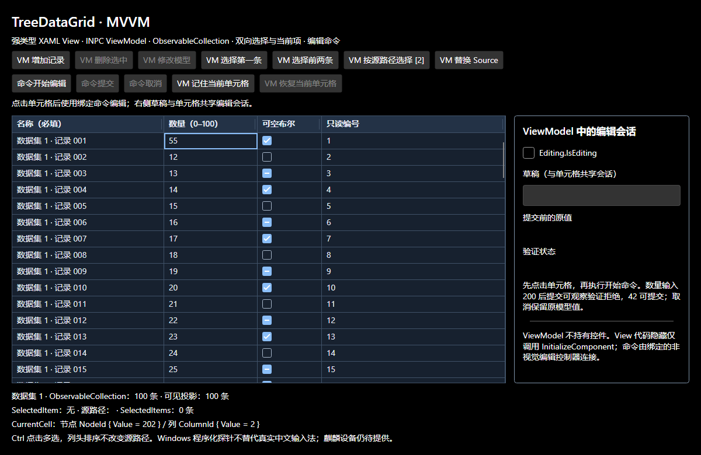
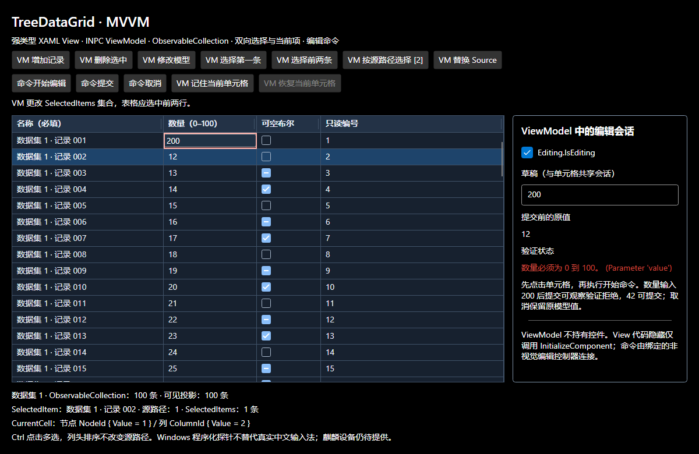

# MVVM 集成验收

2026-10-12，版本 `0.2.0-preview.2`。本轮由数据入口、选择编辑接口、MVVM Demo 三条子任务实施，主任务统一接口、独立复核与集成验收。范围为 Windows 和核心模型。

## 交付

- `Source` 保持原有外部所有权，新增 `ItemsSource` 自动管理平面/层级源，两种入口互斥。XAML 支持直接内容列及层级列内列；层级属性支持明确范围内的 ReflectionBinding。
- `SelectedItem`、`SelectedIndex`、`SelectedItems`、`CurrentCell` 默认 TwoWay。选区使用稳定身份，IndexPath 为源路径；Source 清空后同步清理输出。
- ViewModel 持有非视觉 `TreeDataGridEditCommands`，绑定开始/提交/取消、IsEditing、EditSession、草稿与验证错误。卸载解除控制器连接；重挂保持原会话。
- 完整强类型 XAML View / INPC ViewModel / ObservableCollection Demo，View 代码隐藏只有 InitializeComponent。`--mvvm` 或原窗口顶部按钮进入。
- 官方 v12 的数据/XAML入口已对齐，保留本项目既有选择枚举与类型。没有复制全部官方选择模型或 fluent API，CurrentCell 和命令控制器是扩展。详见 [官方对照](mvvm-official-alignment.md)与 [样例说明](mvvm-demo.md)。

## 最终验收

| 项目 | 最终结果 |
| --- | --- |
| 锁定还原与全解决方案 Release 构建 | 通过，0 警告、0 错误 |
| Core | 93 / 93 |
| Headless | 85 / 85 |
| Themes | 18 / 18 |
| 自动测试总数 | **196 / 196**，无跳过 |
| Windows MVVM 原生窗口探针 | **21 / 21**，2026-10-12 13:54 香港时间 |
| Windows 既有树表回归探针 | **36 / 36**，同一发布目录 |
| API 契约 | 精确快照通过；P1、P2/P3、P4/P5 旧成员均保留 |
| 双 NuGet 包独立消费 | 新缓存，无源码项目引用，compiled MVVM AXAML 实际加载通过 |
| 编译、发布、独立消费者程序集 | 核心和主题 SHA256 分别一致，详见 JSON |

执行入口为 `scripts/Verify.ps1`，包含锁定还原、Release 构建、三个直接 xUnit runner、双包打包和消费者运行。最终消费者目录为 `artifacts/consumer/1ddf16713b294166b9d44c69c744dc5b`。新增消费者窗口验证 ItemsSource 通知、默认 TwoWay SelectedItem / CurrentCell、VM 命令编辑和卸载断开；另验证层级 XAML 内容列、ChildrenBinding / IsExpandedBinding、子集合通知和展开写回。既有消费者继续验证五种列、主题、懒加载、编辑、选区、排序过滤。

独立复核发现并修复集合通知内规范化选择的重入异常、控制器通知内换控制器错误断连；集成测试覆盖不同绑定顺序替换 DataContext、显式清空源、只读命令状态、编辑 reader/validator/writer 回调换 ItemsSource、提交中移动模型触发选择回写、通知中卸载及重挂。初次包与后续构建的程序集哈希不同后，已重新执行完整验收和发布，以上均为最终一致产物的结果。

本轮没有重新宣称性能基准成绩；原 P4/P5 性能归档保持历史证据。最终原生回归仍覆盖十万行虚拟化和百列视口容器约束。

## 使用及产物

```powershell
dotnet run --project samples/TreeDataGrid.Demo -c Release --no-build -- --mvvm
# 或运行最终发布目录
./artifacts/publish/windows/TreeDataGrid.Demo.exe --mvvm
```

本地包：`artifacts/packages/NT.AvaloniaControl.0.2.0-preview.2.nupkg` 与 `NT.AvaloniaControl.Themes.0.2.0-preview.2.nupkg`，未发布到公共包源。

归档记录：[总验收与程序集哈希](validation/mvvm-verification.json)、[MVVM 原生探针](validation/windows-mvvm-smoke.json)、[原有功能回归](validation/windows-mvvm-regression.json)。





截图为 Avalonia RenderTargetBitmap 离屏控件渲染；自动输入为控件路由事件和 TextBox 操作。真实中文输入法、麒麟设备、多 DPI 和完整无障碍验收仍未完成。
